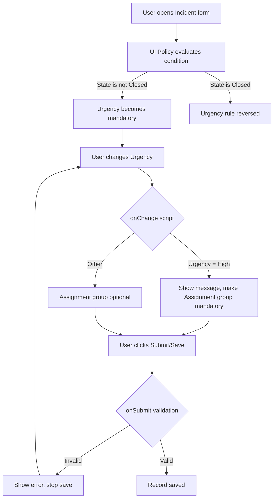
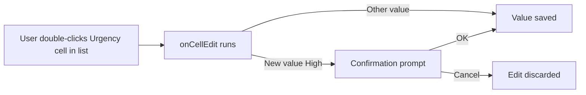

# 2. Architecture and Workflow

## System Architecture

The solution runs entirely on the ServiceNow platform. Rules execute in the **user's browser (client side)**, so feedback is instant and no server round trip is needed.

```
+------------------------------------------------------------+
|                    ServiceNow Instance (PDI)               |
|                                                            |
|   +------------------+        +------------------------+   |
|   |  Incident Table  |<------>|  Business Rules (OOTB) |   |
|   +--------+---------+        +------------------------+   |
|            |                                               |
|   +--------v---------------------------------------------+ |
|   |          Incident Form / List (Browser)              | |
|   |                                                      | |
|   |  UI Policy  ->  UI Policy Actions (Urgency)          | |
|   |  Client Script: onChange | onSubmit | onCellEdit     | |
|   +------------------------------------------------------+ |
+------------------------------------------------------------+
            ^
            |  User (Caller / Service Desk Agent)
```

## Components

| Component | Purpose |
|---|---|
| Incident table | Stores incident records |
| UI Policy | Declarative, no-code form rules based on conditions |
| UI Policy Action | Sets a field mandatory, visible or read-only |
| onChange script | Runs when a field value changes on the form |
| onSubmit script | Validates data when the form is saved |
| onCellEdit script | Runs when a cell is edited in a list |
| `g_form` API | Client-side API used to read and change form fields |

## Workflow



## List View Flow (onCellEdit)



## Execution Order

1. Form loads: onLoad scripts and UI Policies run.
2. Field changes: onChange scripts and UI Policy conditions re-evaluate.
3. Save clicked: onSubmit scripts run. A `false` return stops the save.
4. Server saves the record and normal Business Rules run.
