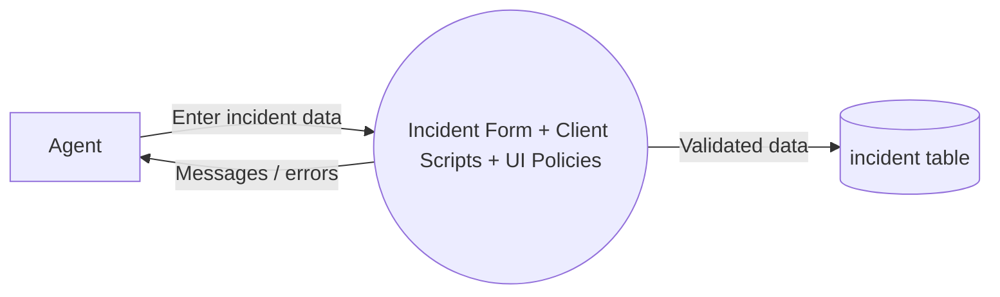

# Phase 2 – Data Flow & User Stories

## DFD Level 0

## User Stories
| ID | Story | Acceptance criteria |
|----|-------|---------------------|
| US1 | As an agent, I want short descriptions validated so tickets are meaningful. | Given < 10 chars, when I submit, then an error shows and save is blocked. |
| US2 | As an agent, I want subcategory cleared on category change. | Given a subcategory, when category changes, then subcategory is empty. |
| US3 | As a manager, I want P1 incidents to always have an assignment group. | Given Priority 1, then Assignment group is mandatory. |
| US4 | As a resolver, I want hold reasons recorded. | Given State = On Hold, then On hold reason is visible and mandatory. |
| US5 | As a resolver, I want resolution details recorded. | Given State = Resolved, then Resolution code and notes are mandatory. |
