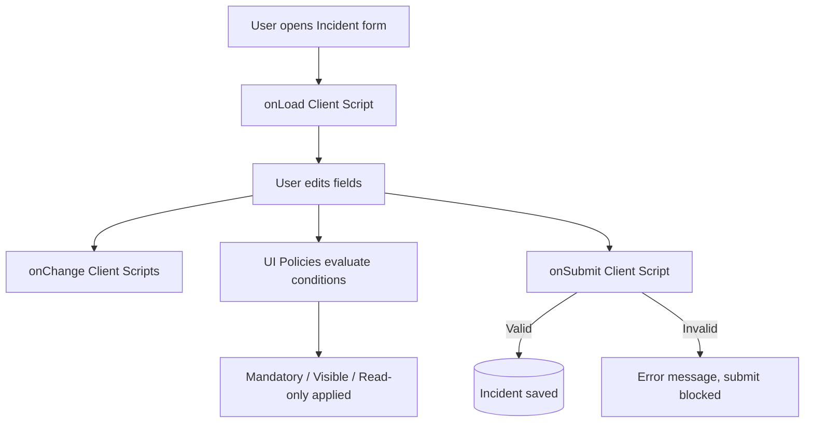

# Implement Client Script and UI Policy (Incident) – ServiceNow


## 📌 Executive Summary
On the ServiceNow **Incident** form, users often submit incomplete or inconsistent data: vague short descriptions, missing hold reasons, missing resolution notes, and critical incidents without an assignment group. This project uses **Client Scripts** and **UI Policies** to enforce data quality **on the form itself**, before the record reaches the server.

## 👥 Project Team
| Name | Role | Responsibility |
|------|------|----------------|
| Rahul | Team Lead | Architecture, project coordination, GitHub submission |
| Dinesh kumar | Member | UI Policies (mandatory / visible rules) |
| Abisheknathan | Member | Client Scripts (onLoad, onChange, onSubmit) |
| Dakshanraj | Member | UAT testing, final report |

## 🎯 Objectives
1. Validate the **Short description** on submit (client-side).
2. Clear **Subcategory** when **Category** changes.
3. Warn the user when **Priority** is set to *1 - Critical*.
4. Make **On hold reason** mandatory/visible when State = *On Hold*.
5. Make **Resolution code / notes** mandatory when State = *Resolved*.
6. Make **Assignment group** mandatory for Priority 1.

## 🏗️ Client Script vs UI Policy
| | Client Script | UI Policy |
|---|---|---|
| Needs code | Yes (JavaScript) | Mostly no (conditions + actions) |
| Types | onLoad, onChange, onSubmit, onCellEdit | On load, Reverse if false, Scripts |
| Best for | Validation, messages, clearing values | Mandatory / visible / read-only |



## 📂 Structure
```
01_phase1_ideation/ … 06_phase6_project_documentation/   phase-wise deliverables
scripts/setup_client_scripts_and_ui_policies.js           background script (optional)
05_phase5_.../01_implementation_artifacts/                client scripts + UI policy specs
05_phase5_.../02_uat_testing/                             UAT test plan
docs/IMPLEMENTATION_GUIDE.md                              step-by-step manual setup
```

## 🚀 Quick Start
Follow [`docs/IMPLEMENTATION_GUIDE.md`](docs/IMPLEMENTATION_GUIDE.md) to create everything manually in a ServiceNow Personal Developer Instance (PDI). Optionally try `scripts/setup_client_scripts_and_ui_policies.js` in **System Definition > Scripts – Background**.

## 🧪 Testing
See [`UAT test plan`](05_phase5_development_and_testing/02_uat_testing/uat_test_plan.md). Fill in the Actual Result / Status columns after running each test on your instance and attach screenshots.
